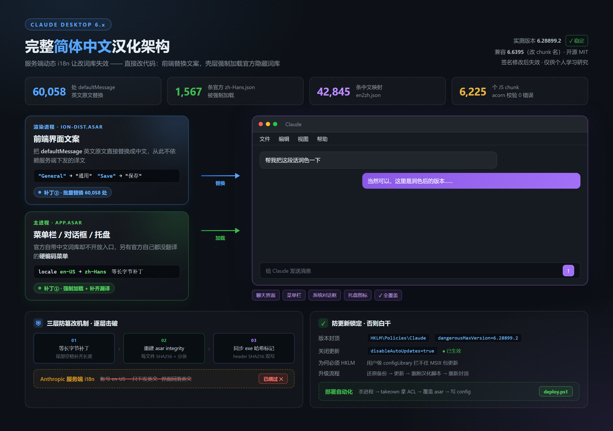
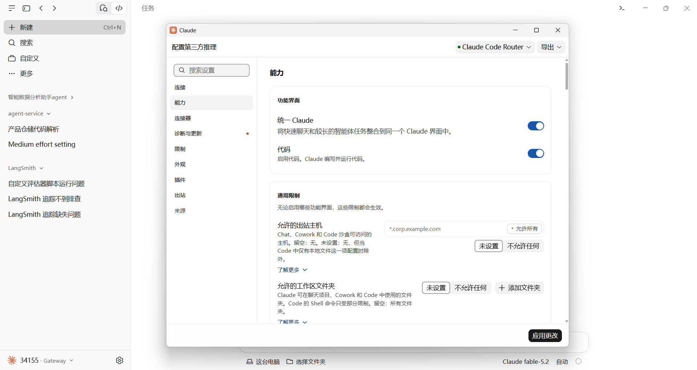
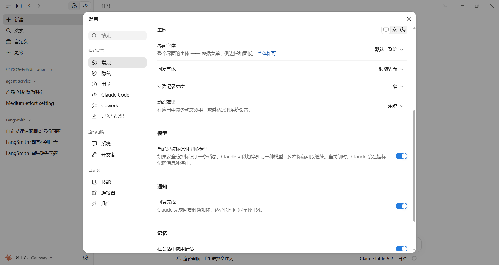

<div align="center">

# Claude Desktop 简体中文汉化

**完整汉化，一次到位 —— 聊天界面 / 菜单栏 / 系统对话框 / 托盘图标，全部中文。**

[](https://github.com/mistfallleaf/claude-desktop-zh-hans/releases)
[](https://github.com/mistfallleaf/claude-desktop-zh-hans)
[](https://github.com/mistfallleaf/claude-desktop-zh-hans)
[](LICENSE)

**快速导航：** [为什么需要](#为什么需要这个项目) · [工作原理](#工作原理) · [快速开始](#快速开始) · [对比社区补丁](#对比社区补丁) · [已知局限](#已知局限)

</div>

---

## ✨ 项目亮点

| | |
|:---|:---|
| 🎯 **完整覆盖** | 60,688 处界面文案 + 全部菜单 / 对话框 / 托盘，不是"补了半天还是英文" |
| 🧠 **直击根因** | 6.x 的服务端动态 i18n 让改词库这条路失效，本项目直接改代码本身 |
| 🛡️ **三层防护全处理** | 等长字节补丁 → 重建 asar integrity → 同步 exe 内哈希标记 |
| 🔒 **防更新** | HKLM 版本封顶 + 关闭自动更新，升级不会悄悄冲掉汉化 |
| 📦 **开箱即用** | 43,460 条词库映射 + 三个脚本 + 排坑文档 |

> **适用版本**：`6.28899.2`（实测）、`6.6395`（改个 chunk 名即可）。
> 旧版（≤5.x，本地静态 i18n）请用社区补丁 [`claude-desktop-zh-cn`](https://github.com/1346956/claude-desktop-zh-cn) v1.4.26 —— 对旧版来说本项目是杀鸡用牛刀。

---

## 为什么需要这个项目

> 如果你试过社区补丁（`claude-desktop-zh-cn` 等），发现覆盖率刷到 98% 界面却还是英文——**这正是本项目要解决的问题**。不是"覆盖率不够高"，而是改本地词库这条路在 6.x 上**根本走不通**。

从某个版本起，Claude Desktop 的前端 i18n 改成了**服务端动态下发**：

- 界面文案是 6 万个 `defaultMessage:"英文"` 硬编码在 JS chunk 里，运行时用消息 id 去 Anthropic 服务器查翻译
- 账号 locale = en-US → 服务器只下发英文 → 界面**永远**显示英文 defaultMessage
- 本地词库（`en-US.json`）？前端代码根本不 import 它——**改词库这条路已经死了**

而壳层（菜单栏 / 托盘 / 对话框）更冤：官方 asar 里**自带完整的 `zh-Hans.json` 中文词库**（1,567 条），只是 UI 不开放入口，启动时的语言白名单里也没有中文。

**本项目的思路：不跟服务端较劲，直接改代码本身。**

- **前端**：把 JS 里的 `defaultMessage:"英文"` 原文批量替换成中文（6 万处），从此不依赖服务端下发的译文
- **壳层**：字节级补丁强制加载官方自带的 `zh-Hans.json` + 替换官方漏翻译的硬编码菜单项

---

## 工作原理



**两条路径，各打各的：**

1. **前端**：把英文原文写死替换成中文 → 服务端下发什么都影响不了它
2. **壳层**：强制 `locale = zh-Hans` 加载官方藏起来的中文词库 → 再补齐官方自己都漏翻的硬编码菜单

## 实际效果

设置界面 —— 侧边栏、分组标题、选项说明全部中文（不是只汉化几个按钮）：

| 配置第三方推理 | 常规设置 |
|:---:|:---:|
|  |  |

> 注：截图中的会话列表为测试内容，界面文案（菜单、标签、按钮、说明文字）均已汉化。

---

## 快速开始

> 环境要求：Windows、Python 3.10+、Node.js（asar 打包 + acorn 校验）、管理员权限（部署）。

```bash
# 0. 定位安装目录（MSIX 版）
APP="C:/Program Files/WindowsApps/Claude_6.28899.2.0_x64__pzs8sxrjxfjjc/app"

# 1. 备份原版 asar（重要！）
cp "$APP/resources/app.asar" app.asar.orig
cp "$APP/resources/ion-dist.asar" ion-dist.asar.orig

# 2. 解包两个 asar
npx @electron/asar extract "$APP/resources/ion-dist.asar" ion-dist-extract
npx @electron/asar extract "$APP/resources/app.asar" app-asar-extract

# 3. 前端替换（60,688 处，几分钟）
python tools/replace_defaultmessage.py ion-dist-extract/assets

# 4. 语法校验（必做！改坏 JS 会白屏）
node -e "
const acorn=require('acorn'),fs=require('fs'),path=require('path');
const report=JSON.parse(fs.readFileSync('replace-report.json','utf8'));
let bad=0;
for(const [rel] of report){
  try{acorn.parse(fs.readFileSync(path.join('ion-dist-extract/assets',rel),'utf8'),{ecmaVersion:'latest',sourceType:'module'})}
  catch(e){bad++;console.log('FAIL',rel,e.message)}
}
console.log('checked',report.length,'failed',bad);
"

# 5. 重打包前端（asar pack 会自动重算每文件 integrity）
npx @electron/asar pack ion-dist-extract ion-dist-new.asar

# 6. 计算 ion-dist 新 header 哈希（部署时要写进 exe）
python -c "
import hashlib,struct
d=open('ion-dist-new.asar','rb').read()
ss=struct.unpack_from('<i',d,12)[0]
print(hashlib.sha256(d[16:16+ss]).hexdigest())
"
```

### 壳层补丁（菜单栏汉化）

壳层两步走：① 强制加载官方 zh-Hans 词库；② 替换官方漏翻译的硬编码菜单项。

**第①步 强制 locale**：在 `app-asar-extract/.vite/build/` 下找到含 `getPreferredSystemLanguages` 的 chunk（6.28899.2 是 `index.chunk-C6TxG41H.js`，6.6395 是 `index.chunk-Da1TsO0P.js`），做两处**等长**字节替换：

```text
# 启动选语言（旧版 6.6395 的函数名不同，模式一致）
原文: CHe(e!==void 0&&xHe().includes(e)?e:yHe())
替换: CHe("zh-Hans"                          )   # 尾部空格补齐等长

# 渲染进程会把 locale 推回 en-US，短路它
原文: function wHe(e){let t=e;if(e!==pHe){
替换: function wHe(e){let t=e;if(0){          # 尾部空格补齐等长
```

**第②步 硬编码菜单项**（官方自己都没翻译的新版调试菜单）：

```bash
python tools/patch_app_asar.py \
  --asar app.asar.orig \
  --out app-patched.asar \
  --entry ".vite/build/index.chunk-C6TxG41H.js" \
  --old "Enable Main Process Debugger" --new "启用主进程调试器" \
  --old "Record Performance Trace"   --new "记录性能追踪" \
  --old "Record Rendering Trace (rolling)" --new "记录渲染追踪（滚动）" \
  --old "Write Main Process Heap Snapshot" --new "写入主进程堆快照" \
  --old "Record Memory Trace (auto-stop)"  --new "记录内存追踪（自动停止）"
```

> 等长替换 + integrity 重建 + 新 header 哈希，脚本自动完成，最后会打印新 header 哈希。
>
> 注：第①步的 locale 补丁目前需按上面的原文/替换手工做（字节级、量小），
> 第②步及以后任何同类改动都用 `patch_app_asar.py`。

### 部署（管理员）

```powershell
powershell -ExecutionPolicy Bypass -File tools/deploy.ps1 `
  -AppDir "$env:ProgramFiles\WindowsApps\Claude_6.28899.2.0_x64__pzs8sxrjxfjjc\app" `
  -IonAsar ion-dist-new.asar -AppAsar app-patched.asar `
  -IonHash "<第6步算出的 ion header 哈希>" `
  -AppHash "<patch_app_asar.py 打印的 app header 哈希>"
```

脚本自动：杀进程 → takeown 拿 ACL → 覆盖 asar → 同步 exe 内两个哈希标记 → 三处 config 写 `locale: zh-Hans`。

### 防更新（必做，否则白干）

```bat
reg add "HKLM\SOFTWARE\Policies\Claude" /v dangerousMaxVersion /t REG_SZ /d 6.28899.2 /f
reg add "HKLM\SOFTWARE\Policies\Claude" /v disableAutoUpdates /t REG_SZ /d true /f
```

`dangerousMaxVersion` = 当前版本号，更新器看到版本已达上限就拒绝升级。**用户级 configLibrary 的 `disableAutoUpdates` 拦不住 MSIX 包更新**，必须写 HKLM。

---

## 对比社区补丁

| 对比项 | 社区补丁 `claude-desktop-zh-cn` | 本项目 |
|:---|:---|:---|
| 适用版本 | ≤ 5.x（旧版静态 i18n） | **6.x**（6.28899.2 / 6.6395） |
| 前端方案 | 改本地 `en-US.json` 词库 | **替换 JS 里 60,688 处 `defaultMessage`** |
| 服务端下发英文时 | 界面回落英文 | 中文已写死，**不受服务端影响** |
| 菜单栏 / 对话框 | 未覆盖 | **强制加载官方隐藏词库 + 补齐硬编码菜单** |
| 实际效果 | 覆盖率数字好看，界面还是英文 | **全中文** |
| 更新防护 | 无 | HKLM 版本封顶 + 自动更新关闭 |

---

## 仓库结构

```text
├── README.md                       本文
├── en2zh.json                      英文原文→中文映射（43,460 条，5MB）
├── docs/
│   ├── architecture.png            架构图（高清渲染）
│   ├── integrity.md                三层防篡改机制详解 + 排坑速查
│   └── screenshots/                实际汉化效果截图
├── tools/
│   ├── replace_defaultmessage.py   前端 defaultMessage 批量替换器
│   ├── patch_app_asar.py           asar 等长字节补丁 + integrity 重建
│   └── deploy.ps1                  提权部署（ACL + 覆盖 + exe 哈希同步）
```

## 关于 en2zh.json

43,460 条映射，三个来源：官方 `en-US.json` 的词条对照、社区补充包、以及机器翻译后的人工精修。品牌名 / API / 占位符 / ICU 格式均已校验。在 6.28899.2 上实测 62,263 条 `defaultMessage` 漏译为 0；后续版本新增文案仍可能回落英文，可按同一流程补充。

## 已知局限

- 官方漏翻译的硬编码字符串（如调试菜单）靠 `patch_app_asar.py` 打补丁，版本升级后需重新核对
- 账号如果在设置里手动切语言，壳层可能被推回英文（已被补丁短路，极端情况需复查）
- 每次 Anthropic 发版，chunk 文件名和函数名都会变，壳层补丁的定位模式见 [`docs/integrity.md`](docs/integrity.md)

## 免责声明

本项目仅供个人学习与技术研究。修改后的应用签名失效，请勿用于分发；使用本工具产生的一切后果由使用者自行承担。Claude Desktop 是 Anthropic 的商标，版权归其所有。

## Credits

- 方法轮验证受社区补丁 [`claude-desktop-zh-cn`](https://github.com/1346956/claude-desktop-zh-cn) v1.4.26 启发（旧版方案）
- 翻译映射部分来源于上述社区项目与公开翻译接口

---

<details>
<summary><b>English Brief</b>（点击展开）</summary>

A toolchain + methodology to fully localize Claude Desktop 6.x to Simplified Chinese. The 6.x frontend uses **server-side dynamic i18n** (local dictionaries are ignored; messages are fetched from Anthropic's catalog based on account locale), which broke all legacy dictionary-patching approaches. This project instead patches the code itself: (1) replaces 60k hardcoded `defaultMessage` English strings in the frontend JS, (2) byte-patches the shell to force-load the bundled-but-hidden `zh-Hans.json` catalog. Includes full handling of the three anti-tamper layers (per-file asar integrity, exe-embedded header hashes, MSIX auto-update) via equal-length binary surgery and an HKLM version-cap policy. Tested on 6.28899.2 / 6.6395.

</details>

---

<div align="center">

**MIT License · Copyright © 2026 mistfall**

[⬆ 回到顶部](#claude-desktop-简体中文汉化)

</div>
